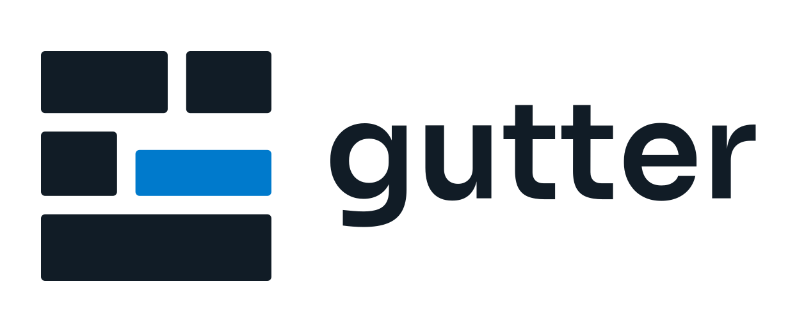

# Gutter

<p align="center">
  <picture>
    <source media="(prefers-color-scheme: dark)" srcset="internal/app/logos/gutter_logo_principal_blanco_accent.svg">
    
  </picture>
</p>

Lector de cómics `.cbr`/`.cbz` de código abierto, escrito en Go con
[Fyne](https://fyne.io/). El nombre hace referencia al *gutter*, el espacio
entre viñetas.

Gutter está diseñado para abrir archivos grandes sin extraerlos completos:
indexa el contenedor, descomprime solo la página solicitada y la mantiene en una
caché LRU en RAM.

## Características

- Lectura de RAR v4/v5 y ZIP, detectados por *magic bytes*: también abre `.cbr`
  que en realidad son ZIP (muy habituales en descargas).
- Decodificación nativa de JPEG, PNG, GIF, WebP, AVIF, BMP y TIFF.
- **Reanudación por cómic**: página, mitad, sentido de lectura, modo y zoom se
  guardan en las preferencias de Fyne y se restauran al volver a abrir.
- **Pantalla de bienvenida con Recientes**: "Continuar leyendo", lista de los
  últimos cómics con página y porcentaje, y opción de limpiar el historial.
- **Arrastrar y soltar** un `.cbr`/`.cbz` sobre la ventana para abrirlo.
- **Tamaño de ventana recordado** entre sesiones (siempre acotado al área útil
  del monitor actual).
- **Menú Archivo/Ver/Traducción/Ayuda** y hoja de atajos con `F1` o `?`.
- **OCR + traducción bajo demanda** con `T`: reconoce el texto de los bocadillos
  y lo sustituye en la página por una capa traducida. En Windows usa el OCR
  integrado del sistema; en Linux/macOS usa Tesseract. Traductores: MyMemory
  (por defecto, sin clave), LibreTranslate o DeepL.
- **Asociación opcional en Windows** de `.cbr`/`.cbz` con Gutter desde el menú
  Archivo; solo escribe en `HKCU\Software\Classes` y pide confirmación.
- **Zoom al 65 % del ancho disponible por defecto** y scroll vertical/horizontal
  para leer el texto de las viñetas sin forzar la página entera en la ventana.
- Flechas ↑/↓ para desplazar el scroll vertical y rueda del ratón para ambos ejes.
- **Salto directo de página con `G`**: pulsa `G`, escribe el número y confirma con
  `Enter`; aparece un indicador flotante con el rango válido y avisa si el número
  no existe. `Esc` o `Retroceso` cancelan/corrigen.
- Controles de zoom (−, %, +, ajustar al ancho), `0`, `1`, `+`, `−` y modo de
  lectura limpia a pantalla completa (`F11` / `Esc`); en modo limpio el cursor
  también se oculta y la esquina superior derecha muestra `Página X / N`.
- Diálogo "Abrir" con filtro `.cbr`/`.cbz` y tamaño ampliado para navegar.
- Barras superior e inferior compactas y centradas. En ventanas estrechas la
  barra inferior trunca el progreso y oculta los controles de zoom para evitar
  solapamientos.
- Corte de doble página con `SubImage` y selector Occidental/Manga.
- Caché LRU de 96 MiB con *single-flight*, prefetch de la página anterior y
  siguiente, y cancelación de lecturas al cambiar rápidamente de página.
- **RAR sólidos:** progreso del recorrido secuencial en la barra inferior y
  `Esc` para cancelar un salto largo, volviendo a la última página dibujada.
- Caché de miniaturas independiente (24 MiB) con reducción a resolución de
  miniatura, lista para una tira o rejilla de páginas.
- Tema oscuro fijo: `#121212`, paneles `#1E1E1E` y acento `#007ACC`.
- Ventana inicial segura (900×800 objetivo), ajustada al área útil del monitor
  y siempre en modo ventana normal; logo SVG y navegación por teclado.

## Estructura

```
gutter/
├── main.go                 # Único punto de entrada: llama a app.Run().
├── rsrc_windows_amd64.syso # Icono y versión incrustados en Gutter.exe.
├── build.ps1               # Compilación de Gutter.exe en Windows.
├── assets/                 # Recursos de compilación (icono .ico y .rc).
├── go.mod / go.sum
├── README.md
└── internal/
    ├── app/                # Lógica principal de la aplicación (paquete app).
    │   ├── app.go          # Struct gutterApp, NewGutterApp, Run(), arranque.
    │   ├── dialogs.go      # Diálogos, Abrir cómic, Cancelar carga.
    │   ├── help.go         # Menú Archivo/Ver/Traducción/Ayuda, F1, "Acerca de".
    │   ├── hud.go          # HUD de página en pantalla completa y selector G.
    │   ├── library.go      # Progreso persistente, recientes, bienvenida.
    │   ├── navigation.go   # Zoom, scroll, paginación, prefetch, updateControls.
    │   ├── run.go          # Función Run() (arranque de la app).
    │   ├── translate_ui.go # Activación de OCR/traducción y diálogo de config.
    │   ├── ui.go           # showPage, reportLoadError, toggleCleanMode, handleKey.
    │   └── logos/          # Logotipos SVG (se embeben en el binario).
    │       └── *_test.go   # Pruebas unitarias del paquete app.
    ├── backend/            # Índice RAR/ZIP, extracción, decodificación, caché.
    │   ├── backend.go
    │   └── *_test.go
    ├── ocr/                # OCR (Windows/Tesseract) y traducción.
    │   ├── ocr*.go
    │   ├── translate.go
    │   ├── overlay.go
    │   └── *_test.go
    ├── cursor/             # Ocultación del cursor en modo limpio.
    │   └── cursor.go
    ├── screen/             # Área útil del monitor principal (desktop/mobile).
    │   ├── screen_desktop.go
    │   └── screen_mobile.go
    ├── theme/              # fyne.Theme con la paleta y tipografía de Gutter.
    │   └── theme.go
    └── ui/                 # Layouts y Scroll sin sombras de Fyne.
        ├── layouts.go      # PageLayout, RootLayout, BottomBarLayout, etc.
        └── scroll.go       # ScrollSinSombras, NewScrollSinSombras.
```

### Arquitectura de paquetes

- **`internal/app`**: Orquesta la ventana Fyne, el ciclo de vida de los cómics, la UI de lectura, el HUD, los menús y los diálogos. Es el paquete principal de la aplicación.
- **`internal/backend`**: Índice de archivos `.cbr`/`.cbz` (RAR v4/v5 y ZIP), extracción selectiva de páginas, decodificación multiformato y caché LRU.
- **`internal/ocr`**: Motor de OCR (Windows integrado o Tesseract), traducción (MyMemory/LibreTranslate/DeepL) y capa de bocadillos traducidos.
- **`internal/theme`**: Paleta de colores (`#121212`, `#1E1E1E`, `#007ACC`) y tema oscuro fijo de Fyne.
- **`internal/ui`**: Layouts personalizados (`PageLayout`, `RootLayout`, `BottomBarLayout`, etc.) y el `ScrollSinSombras` que elimina sombras internas de Fyne.
- **`internal/cursor`**: `CleanCursor` para ocultar el puntero en modo lectura limpia.
- **`internal/screen`**: `PrimaryWorkArea()` para obtener el área útil del monitor sin la barra de tareas.
- **`internal/associate`**: Asociación de archivos `.cbr`/`.cbz` con Gutter en Windows (registro en `HKCU`).

Los paquetes bajo `internal/` son privados al módulo `gutter` y no pueden importarse desde fuera.

## Requisitos

- **Go 1.26 o superior.**
- Un compilador de C para Fyne (el backend de escritorio usa OpenGL/GLFW):
  - **Windows:** LLVM-MinGW (recomendado) o MinGW-w64/WinLibs con `gcc` en
    el `PATH`.
  - **Linux:** `sudo apt install gcc libgl1-mesa-dev xorg-dev`
  - **macOS:** `xcode-select --install`
- El decodificador AVIF es *cgo-free*: usa libavif/dav1d compilado a WASM con
  wazero. La primera decodificación AVIF tarda algo más porque compila el WASM.
- **OCR/traducción:** en Windows 10/11 no hace falta instalar nada; el OCR usa
  los paquetes de idioma del sistema (Configuración > Hora e idioma > Idioma y
  región). En Linux/macOS hay que instalar `tesseract` y el paquete de idioma
  correspondiente. La traducción requiere conexión a Internet salvo que se
  apunte a un servidor LibreTranslate local.

## Instalación de dependencias

Desde la raíz del proyecto:

```bash
go get fyne.io/fyne/v2@v2.8.2
go get github.com/nwaples/rardecode/v2@v2.4.5
go get golang.org/x/image@v0.47.0
go get github.com/gen2brain/avif@v0.6.0
go mod tidy
```

`golang.org/x/image` aporta los decodificadores **WebP**, BMP y TIFF.
`gen2brain/avif` registra **AVIF** en `image.Decode` sin dependencias nativas.

## Ejecutar

```bash
# Desarrollo (Windows / Linux / macOS)
CGO_ENABLED=1 go run .
```

También puedes abrir un cómic directamente:

```bash
CGO_ENABLED=1 go run . "C:\Comics\Sandman 001.cbr"
```

En **PowerShell**:

```powershell
$env:CGO_ENABLED="1"
go run .
```

Si `gcc` no está en el `PATH` de la sesión, añade el directorio `bin` de
MinGW-w64:

```powershell
$env:Path = "C:\ruta\a\mingw64\bin;$env:Path"
```

## Compilar

**Windows (recomendado):**

```powershell
.\build.ps1
```

Genera `Gutter.exe` sin consola y con símbolos eliminados. Para depurar:

```powershell
.\build.ps1 -Debug
```

Si PowerShell bloquea scripts:

```powershell
powershell -ExecutionPolicy Bypass -File .\build.ps1
```

El script detecta automáticamente `clang` o `gcc` (incluidas las instalaciones
hechas con Winget) y configura `CGO_ENABLED=1`. LLVM-MinGW (`clang`) suele
compilar Fyne bastante más rápido que GCC.

**Windows (manual):**

```powershell
$env:CGO_ENABLED="1"
$env:CC="clang"
go build -trimpath -ldflags="-s -w -H windowsgui" -o Gutter.exe .
```

**Linux / macOS:**

```bash
CGO_ENABLED=1 go build -trimpath -ldflags="-s -w" -o gutter .
```

## Pruebas

```bash
CGO_ENABLED=1 go test -v ./...
```

Las pruebas cubren orden natural de páginas, conversión de imágenes
indexadas/GIF a RGBA, el corte de mitades, la selección izquierda/derecha según
el sentido de lectura, el porcentaje de progreso, la restauración de sesión, el
round-trip de la lista de recientes, la agrupación de líneas OCR en bocadillos,
el renderizado de la capa traducida, las peticiones a LibreTranslate/DeepL,
la cancelación de cargas, el cierre sincronizado del ZIP y la caché separada de
miniaturas. El motor se validó además con cómics RAR5 normales y sólidos
generados para la ocasión, con páginas AVIF y WebP reales, y con una página de
bocadillos traducida de extremo a extremo usando el OCR integrado de Windows y
MyMemory.

### Benchmarks

```bash
CGO_ENABLED=1 go test -run '^$' -bench . -benchmem ./...
```

Incluye `BenchmarkPageCacheLRU`, `BenchmarkNaturalOrder`,
`BenchmarkSpreadDetection`, `BenchmarkCropHalf` y `BenchmarkMakeThumbnail`.


## Atajos de teclado

| Tecla | Acción |
| --- | --- |
| `→` | Página/mitad siguiente (Occidental) o anterior (Manga). |
| `←` | Página/mitad anterior (Occidental) o siguiente (Manga). |
| `↑` / `↓` | Desplazar el scroll verticalmente. |
| `Inicio` / `Fin` | Primera / última página. |
| `G` + número + `Enter` | Ir a una página concreta (indicador flotante). |
| `+` o `=` | Aumentar zoom. |
| `-` | Reducir zoom. |
| `0` | Ajustar la página al ancho disponible. |
| `1` | Zoom 100 % (1 píxel de imagen = 1 unidad Fyne). |
| `F11` | Entrar/salir del modo limpio a pantalla completa (muestra `Página X / N` arriba a la derecha). |
| `Esc` | Cancelar una carga larga (RAR sólido) o salir del modo limpio. |
| `F1` o `?` | Mostrar la hoja de atajos. |
| `T` | Reconocer y traducir la página actual (otra pulsación oculta la capa). |
| `Ctrl+O` | Abrir un cómic. |
| `Ctrl+R` | Abrir la lista de recientes. |
| Rueda del ratón | Desplazar la página vertical u horizontalmente. |
| Arrastrar y soltar | Abrir un `.cbr`/`.cbz` sobre la ventana. |

## Tema y mapeo a Fyne v2

Fyne v2 sustituyó los métodos `BackgroundColor()`, `ButtonColor()`, etc. por un
único método `Color(ThemeColorName, ThemeVariant)`. El mapeo de Gutter es:

| Requisito | Nombre en Fyne v2 | Color |
| --- | --- | --- |
| Fondo de la aplicación / lienzo | `ColorNameBackground` | `#121212` |
| Paneles, menús y barras | `ColorNameHeaderBackground`, `ColorNameMenuBackground`, `ColorNameInputBackground`, `ColorNameOverlayBackground` | `#1E1E1E` |
| Acento, foco y acción primaria | `ColorNamePrimary`, `ColorNameFocus` | `#007ACC` |
| Botones | `ColorNameButton` | `#252526` |
| Hover | `ColorNameHover` | `#333333` |
| Texto principal | `ColorNameForeground` | `#E1E1E1` |
| Texto sobre acento | `ColorNameForegroundOnPrimary` | `#FFFFFF` |

> En Fyne v2, `ColorNamePrimary` **es el color de acento**, no el color del texto.
> El texto se controla con `ColorNameForeground`. No existe una constante
> `CanvasBackgroundColor`; los paneles se pintan con los nombres de superficie y
> con rectángulos explícitos en la UI.


## Notas de implementación

- **Fyne no tiene `canvas.ImageScaleContain`.** En Fyne v2, el ajuste con
  relación de aspecto se hace con `FillMode = canvas.ImageFillContain`; el campo
  `ScaleMode` (`ImageScaleFastest`) controla la interpolación. Gutter usa ambos.
- **Corte de páginas:** `CropHalf` define el recorte con `RGBA.SubImage` y luego
  lo compacta a un RGBA contiguo. Esto es necesario porque el cargador OpenGL de
  Fyne sube `Pix` de forma contigua y un `SubImage` conserva el `Stride` de la
  página completa (de lo contrario las filas saldrían desplazadas).
- **Zoom y scroll:** la página se dibuja con `canvas.Image` dentro de un
  `container.NewScroll` con dirección `ScrollBoth`. Un `pageLayout` propio fija
  el `MinSize` de la página según el zoom; así Fyne muestra las barras solo
  cuando la página supera el viewport. El modo por defecto es *ajustar al ancho*
  al 65 % (vertical scroll), y el zoom manual permite llegar al 100 % y usar
  también el scroll horizontal. ↑/↓ simulan un evento de rueda sobre el Scroll.
- **Barras compactas:** la toolbar usa padding propio de 4 px y un logo de
  96×40; la barra inferior mide ~50 px. `F11` oculta ambas y activa pantalla
  completa sin destruir el canvas.
- **Diálogo de apertura:** `dialog.NewFileOpen` con
  `storage.NewExtensionFileFilter([]string{".cbr", ".cbz"})` y
  `Resize(880, 680)`. Los controles devuelven el foco al canvas al terminar, de
  modo que las flechas siguen controlando página y scroll.
- **Barra inferior responsiva:** un `bottomBarLayout` propio reserva el ancho
  de navegación y centra los controles. El label de progreso ocupa el espacio
  flexible y usa truncado con puntos suspensivos; por debajo de 680 unidades
  se ocultan los controles de zoom (siguen disponibles con `0`, `1`, `+`, `−`)
  para evitar colisiones en ventanas estrechas.
- **Arranque seguro:** la ventana nace en 760×480, en modo ventana y centrada.
  En `OnStarted`, cuando Fyne ya conoce el DPI real, se consulta el área útil
  del monitor (sin barra de tareas) y se ajusta a un máximo de 900×800. Así la
  barra de título nunca queda fuera de pantalla. `F11` solo actúa por acción
  explícita del usuario.
- **Detección de contenedor:** no se usa la extensión. Se leen los *magic
  bytes*: `Rar!` para RAR y `PK` para ZIP. Por eso también abre `.cbr` que en
  realidad son ZIP, algo muy común en descargas.
- **ZIP abiertos:** para ZIP se mantiene abierto el descriptor del archivo
  mientras dura la sesión (se cierra al cambiar de cómic). Las entradas
  cifradas con contraseña se omiten porque `archive/zip` no las descifra.
- **RAR sólidos:** se detectan automáticamente. Si `File.Open()` no es posible,
  el backend cae a lectura secuencial y la caché evita releer al volver atrás.
- **Icono de ventana:** se usa `internal/app/logos/gutter_icono_blanco_accent.svg` (cuadrado)
  para que se vea bien en la barra de tareas. Si existe `internal/app/logos/gutter_logo.svg`,
  ese tiene prioridad. Las rutas se configuran en `iconCandidates`/`logoCandidates`
  de `ui.go`.
- **Progreso y recientes:** se guardan como JSON en `fyne.Preferences` bajo
  `reader.recent` (máximo 15 entradas). La ruta se normaliza a absoluta y, en
  Windows, se compara sin distinguir mayúsculas. Al mostrar cada página se
  actualiza la entrada y al cerrar se guarda también el tamaño de ventana.
- **Ventana:** `fitWindowToPrimaryScreen` recupera `ui.window.width`/`height` y
  los acota al área útil actual. Si se cierra en modo limpio se conserva el
  último tamaño de ventana normal (`lastWindowedSize`).
- **Arrastrar y soltar:** `Window.SetOnDropped` filtra URIs `file` y extensiones
  `.cbr`/`.cbz`; el resto muestra un error.
- **Cursor en modo limpio:** un `canvas.Rectangle` transparente que implementa
  `desktop.Cursorable` y devuelve `desktop.HiddenCursor`. Al no implementar
  `Tappable` ni `Scrollable`, los clics y la rueda siguen llegando a la página.
- **Asociación de archivos:** en Windows se escriben las claves del usuario
  (`Software\Classes\.cbr`, `.cbz`, `Gutter.Comic\shell\open\command`) y se avisa
  al Explorador con `SHChangeNotify`. No requiere administrador; el resto de
  plataformas muestran un stub que no registra nada.
- **OCR bajo demanda:** `T` captura la imagen que se está mostrando (página
  completa o mitad), la escribe en un PNG temporal y ejecuta el motor
  disponible. Windows usa `Windows.Media.Ocr` desde PowerShell con
  `-ExecutionPolicy Bypass`; si falla, cae a Tesseract. El OCR nunca se ejecuta
  al abrir una página, solo cuando el usuario lo pide.
- **Bocadillos:** las líneas OCR se agrupan con una heurística de proximidad
  vertical y solapamiento horizontal. Cada grupo se traduce y se dibuja en una
  capa `image.RGBA` transparente del tamaño de la página; Fyne la escala y
  desplaza junto con la imagen original, así que el zoom y el scroll siguen
  funcionando sin recalcular posiciones.
- **Traducción:** MyMemory es el proveedor por defecto (sin clave, con límite
  gratuito diario). LibreTranslate acepta un endpoint propio y DeepL una clave
  API. Solo se envía el texto reconocido; la imagen no sale del equipo. Las
  traducciones se cachean en memoria por cómic/página/mitad/configuración y las
  traducciones parciales no se cachean para poder reintentarlas.
- **Fuentes:** la capa usa la fuente Go Regular para alfabetos latinos y busca
  una fuente CJK del sistema para chino, japonés o coreano. Si no encuentra
  ninguna, mantiene el bocadillo original en vez de dibujar caracteres vacíos.
- **Caché de miniaturas:** `Comic.ThumbnailContext` mantiene una LRU propia de
  24 MiB, separada de los 96 MiB de páginas completas. Lee y decodifica la
  entrada, la reduce con `x/image/draw` y guarda solo el RGBA pequeño, de modo
  que una futura tira o rejilla de miniaturas no desplace la página en lectura.
- **Cancelación y single-flight:** cada carga usa un contexto propio y un
  `loadCall` con contador de referencias. Si todos los que esperan cancelan, se
  cancela la lectura real; `CancelLoads` retira además la llamada del mapa para
  que una carga nueva del mismo nombre no se enganche a un trabajo cancelado.
- **Cierre seguro:** `Comic.Close` marca el cómic como cerrado, cancela las
  lecturas, espera `loadWG` y solo entonces cierra el descriptor del ZIP. Un
  prefetch en vuelo nunca puede leer de un archivo ya cerrado.
- **Prefetch bidireccional:** tras dibujar una página se precargan la anterior y
  la siguiente con un contexto separado del progreso de la página actual. Al
  cambiar de página se cancelan ambos contextos y las lecturas antiguas.
- **RAR sólidos:** el recorrido secuencial informa cada 10 páginas mediante un
  callback en el contexto. La barra inferior muestra `RAR sólido 120/455` y
  `Esc` cancela la carga, restaurando la última página realmente dibujada.
- **HUD flotante (`hud.go`):** el indicador de página y el selector `G` viven en
  un `container.NewStack` sobre el área de lectura, no en el árbol del scroll,
  para que el zoom y el desplazamiento no los muevan. Detalle importante de
  Fyne 2.8: el recorrido de pintado solo desciende a los hijos cuando el tipo
  dinámico del objeto es exactamente `*fyne.Container`; por eso `floatingPill`
  expone su contenedor real en `root` y es ese valor el que se inserta en el
  árbol. `Container.Show()` tampoco marca el lienzo como sucio, así que el HUD
  se refresca explícitamente después de mostrarse. En modo limpio el menú
  principal también se retira (`SetMainMenu(nil)`) y se restaura al salir.

## Licencia

Este proyecto se distribuye como código abierto. Añade el archivo `LICENSE`
con la licencia que prefieras (MIT, Apache-2.0, GPL-3.0, etc.).
